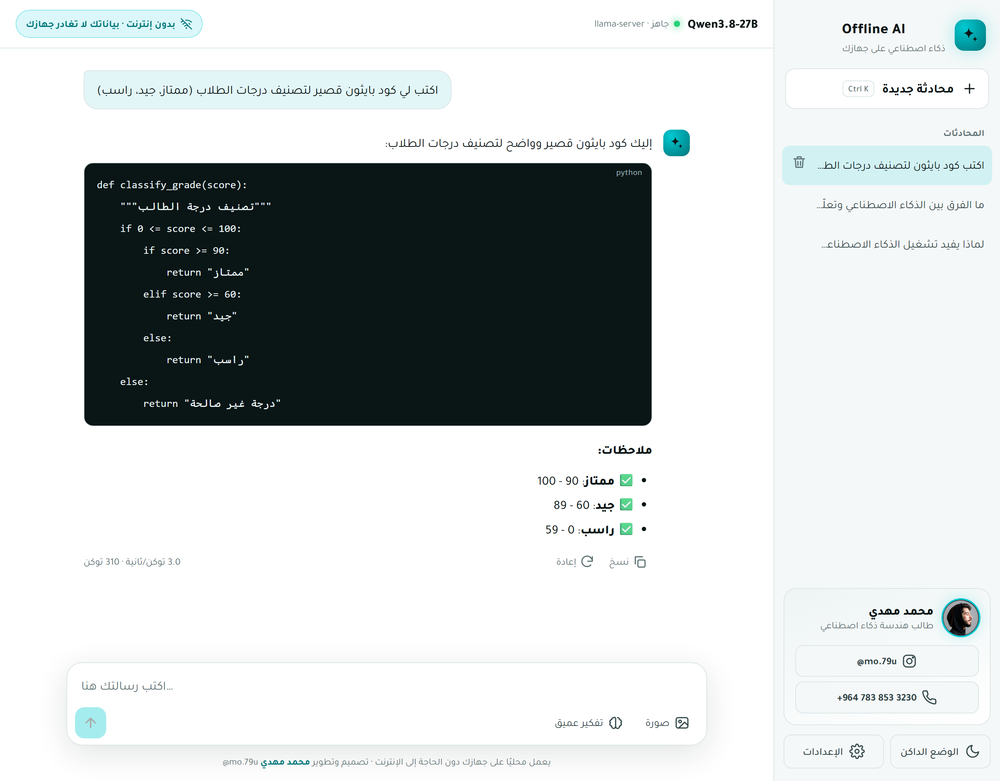

<div align="center">


# Offline AI

**واجهة محادثة عربية احترافية لنماذج الذكاء الاصطناعي المحلية — تعمل على جهازك دون إنترنت**

[](https://instagram.com/mo.79u)


<br>

## 📘 [ابدأ من هنا: دليل التشغيل المصوّر (PDF)](دليل-التشغيل.pdf)

دليل عربي من 9 صفحات يشرح كل شيء خطوة بخطوة بالصور، لأي شخص حتى لو لم تكن لديه خبرة بالحاسوب.
**اضغط على الرابط أعلاه، ثم طبّق الخطوات بالترتيب.**

<br>



</div>

---

## ✨ المميزات

- 🔒 **دون إنترنت:** النموذج يعمل على جهازك، ولا تغادر محادثاتك جهازك أبدًا
- 🧩 **نماذج من Qwen وGoogle وOpenAI:** من نموذج خفيف لحاسوب بذاكرة `4 GB` إلى نماذج قوية للأجهزة المتقدمة
- 🖼️ **فهم الصور:** ارفع صورة (أو اسحبها، أو الصقها بـ `Ctrl+V`) واسأل عنها
- 🧠 **تفكير عميق:** زر يجعل النموذج يفكّر قبل الإجابة، مع إمكانية عرض تفكيره
- 💬 **محادثات محفوظة** في المتصفح يمكنك العودة إليها متى شئت
- 🌗 **وضع فاتح وداكن** بهوية فيروزية، و**تصميم متجاوب** يعمل على الشاشات الصغيرة
- ⚡ **سرعة كل إجابة** معروضة بالرمز في الثانية
- 🆓 **مجاني ومفتوح المصدر:** دون اشتراك ودون حد للرسائل

## 🧩 اختر النموذج المناسب لجهازك

نماذج من **Alibaba (Qwen)** و**Google (Gemma)** و**OpenAI (gpt-oss)**، مرتّبة من الأخف إلى الأثقل:

| النموذج | الشركة | الحجم | الذاكرة (RAM) | الصور | أمر التنزيل |
|---|---|---|---|---|---|
| Qwen3.5-0.8B | Alibaba | 1.3 GB | 4 GB | ✅ | `ollama pull qwen3.5:0.8b` |
| Qwen3.5-2B | Alibaba | 3 GB | 8 GB | ✅ | `ollama pull qwen3.5:2b` |
| Qwen3.5-4B | Alibaba | 4 GB | 8 GB | ✅ | `ollama pull qwen3.5:4b` |
| Gemma 4 E2B | Google | 4.6 GB | 8 GB | ✅ | `ollama pull gemma4:e2b-it-q4_K_M` |
| Gemma 4 E4B | Google | 6.6 GB | 12 GB | ✅ | `ollama pull gemma4:e4b-it-q4_K_M` |
| **Qwen3.5-9B ⭐** | Alibaba | 7 GB | 16 GB | ✅ | `ollama pull qwen3.5:9b` |
| Gemma 4 12B | Google | 8 GB | 16 GB | ✅ | `ollama pull gemma4:12b-it-q4_K_M` |
| gpt-oss-20B | OpenAI | 14 GB | 16 GB | ❌ | `ollama pull gpt-oss:20b` |
| Qwen3.8-27B | Alibaba | 17 GB | 32 GB | ✅ | `ollama pull qwen3.8:27b-q4_K_M` |
| Gemma 4 26B | Google | 18 GB | 32 GB | ✅ | `ollama pull gemma4:26b-a4b-it-q4_K_M` |
| Gemma 4 31B | Google | 20 GB | 32 GB | ✅ | `ollama pull gemma4:31b-it-q4_K_M` |
| Qwen3.6-35B-A3B | Alibaba | 24 GB | 32 GB + Page File | ✅ | `ollama pull qwen3.6:35b-a3b-q4_K_M` |

⭐ الخيار المقترح لأغلب الأجهزة الحديثة. النموذجان الأصغر (0.8B و2B) سريعان لكن دقتهما محدودة وقد يخطئان في المعلومات، فهما للتجربة والأجهزة الضعيفة. الأحجام تقريبية حسب [مكتبة Ollama](https://ollama.com/library).
لا تتوفر حاليًا نماذج مفتوحة من Anthropic (Claude) يمكن تشغيلها على الجهاز، لذا لا يدعمها المشروع.
## 🚀 التشغيل في 4 خطوات

> 📘 للشرح الكامل بالصور، افتح [دليل التشغيل PDF](دليل-التشغيل.pdf).

**1. ثبّت Ollama** من [ollama.com/download](https://ollama.com/download).

**2. نزّل النموذج** المناسب لجهازك من الجدول أعلاه، بنسخ أمره ولصقه في `Command Prompt`. مثال:

```bash
ollama pull qwen3.5:9b
```

**3. نزّل هذا المشروع** من زر **Code ← Download ZIP**، ثم افتح مجلد `Downloads`، وانقر بزر الفأرة الأيمن على الملف المضغوط ← **Extract All**، وامسح المسار واكتب `D:\` ← **Extract**. بعدها افتح القرص `D:` وغيّر اسم المجلد `offline-ai-main` إلى `offline-ai`.

> [!IMPORTANT]
> **يجب أن يكون المشروع كاملًا في `D:\offline-ai`**، وفيه ملف `start.bat` مباشرةً (`D:\offline-ai\start.bat`). إذا لم يكن في جهازك قرص `D`، فاستخدم `C:\` و`C:` بدلًا منه.

**4. شغّل الواجهة على نموذجك (المرة الأولى)**: افتح `Command Prompt`، وانتقل إلى مجلد المشروع:

```bash
cd /d D:\offline-ai
```

ثم اكتب `start.bat` متبوعًا باسم النموذج الذي نزّلته:

```bash
start.bat qwen3.5:9b
```

سيشغّل `start.bat` برنامج Ollama تلقائيًا، ويفتح الواجهة في المتصفح على `http://localhost:5180` والنموذج جاهز.

**في المرات التالية**: افتح المجلد `D:\offline-ai` وانقر نقرًا مزدوجًا على `start.bat`، فتُفتح الواجهة على آخر نموذج شغّلته.

### ⚠️ إذا ظهر خطأ `unable to allocate CUDA_Host buffer`

يعني ذلك أن الذاكرة لا تكفي لتحميل النموذج بالطريقة العادية. اختر نموذجًا أصغر من الجدول، أو شغّل **`start-lowmem.bat`** بدلًا من `start.bat`؛ فهو يشغّل النموذج نفسه عبر `llama-server` (المرفق مع Ollama) بقراءته من القرص مباشرةً، ويعمل حتى دون تفعيل Page File في Windows (اختُبر مع Qwen3.8-27B).

```bash
start-lowmem.bat -GpuLayers 10
```

| الخيار | الافتراضي | الوصف |
|---|---|---|
| `-Model` | `qwen3.8:27b-q4_K_M` | النموذج الذي نزّلته بالأمر `ollama pull` |
| `-GpuLayers` | `14` | عدد الطبقات على بطاقة الرسوميات (أكثر = أسرع، لكنه يحتاج ذاكرة أكبر) |
| `-Ctx` | `8192` | ذاكرة المحادثة بالرموز |
| `-NoVision` | — | يوقف فهم الصور لتوفير نحو `1 GB` من ذاكرة بطاقة الرسوميات |

## ❓ أسئلة شائعة

**هل الاستخدام محدود؟** لا. لا اشتراك ولا حد للرسائل. الحد الوحيد هو ذاكرة المحادثة (نحو 8 آلاف رمز)، فإذا طالت المحادثة كثيرًا فابدأ محادثة جديدة.

**هل تُرسَل محادثاتي إلى أي جهة؟** لا. النموذج والمحادثات على جهازك فقط، والمحادثات محفوظة في متصفحك.

**هل يمكنني استخدام أكثر من نموذج؟** نعم. نزّل ما تريد بالأمر `ollama pull`، ثم بدّل بينها من ⚙️ **الإعدادات** في الواجهة.

## 📁 محتويات المشروع

```
دليل-التشغيل.pdf                  دليل التشغيل المصوّر (ابدأ من هنا)
start.bat                         التشغيل العادي عبر Ollama (start.bat <اسم النموذج> لاختياره مباشرةً)
start-lowmem.bat                  التشغيل باستهلاك أقل للذاكرة
index.html                        الواجهة
assets/                           التصميم والمنطق والخط (Tajawal) وصورة المطوّر
scripts/serve.ps1                 خادم محلي صغير للواجهة (دون Python أو Node)
scripts/start-llama-server.ps1    تشغيل النموذج باستهلاك أقل للذاكرة
docs/guide/                       مصدر دليل التشغيل وصوره
```

---

## English

**Offline AI** is a polished, Arabic-first (RTL) chat interface for local LLMs (Qwen, Google Gemma 4, OpenAI gpt-oss). It talks to **Ollama** or to the
**llama-server** bundled inside Ollama, supports **image input**, an optional **thinking mode**, saved chats,
light/dark themes, and shows tokens/second for every reply. No internet, no accounts, no telemetry.

**Quick start:** install [Ollama](https://ollama.com/download) → pull a model from the table above (e.g. `ollama pull qwen3.5:9b`) → download this repo (Code → Download ZIP), Extract All to `D:\` and rename the folder to `offline-ai` → first time, in a Command Prompt run `cd /d D:\offline-ai` then `start.bat <model>`, e.g. `start.bat qwen3.5:9b` → after that, just double-click `D:\offline-ai\start.bat` (opens the last model used).
A full illustrated guide (Arabic) is in [`دليل-التشغيل.pdf`](دليل-التشغيل.pdf).

---

<div align="center">

### 👨‍💻 المطوّر


**محمد مهدي — Mohammed Mahdi**
طالب هندسة ذكاء اصطناعي

[](https://instagram.com/mo.79u)
[](https://wa.me/9647838533230)

إذا أعجبك المشروع، فتابعني على Instagram وضع ⭐ للمشروع.

© 2026 محمد مهدي — مرخّص بموجب [MIT](LICENSE). يجب الإبقاء على حقوق المطوّر عند نشر المشروع أو تعديله.

</div>
